<!-- hero: the shirt-rip reveal (static art: python scripts/make_reveal_svg.py) -->

  

  

<!-- about: ASCII portrait + agent card in one panel (python scripts/compose_about.py) -->

  

<!-- activity: contribution skyline + the Repo Express, refreshed daily by the workflow -->

