<!--
  This is your PROFILE README. It goes in a repo named exactly after your
  username (e.g. github.com/OCTOCAT/OCTOCAT) so GitHub shows it on your profile.
  Replace the ALL-CAPS placeholders. Every panel is exactly 860 wide; about.svg is built
  by scripts/compose_about.py from the portrait + info card, so no <table>.
-->

<!-- hero: the shirt-rip reveal (static art: python scripts/make_reveal_svg.py) -->

  

  

<!-- about: ASCII portrait + agent card in one panel (python scripts/compose_about.py) -->

  

<!-- activity: contribution skyline + the Repo Express, refreshed daily by the workflow -->

  

<!-- departures: the latest commit to each recently active public repo, refreshed daily -->

  

<!-- trophy case: click to open; the summary count is rewritten daily by scripts/render_trophies_svg.py -->

<!-- trophies:summary --><b>🏆 Trophy case</b> · click to open<!-- /trophies:summary -->

 

